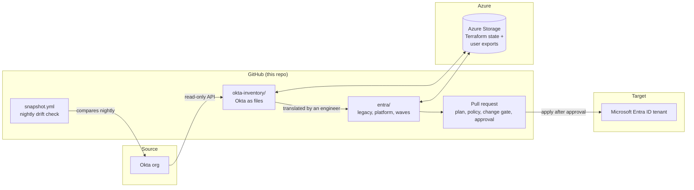

# Okta to Entra Migration Factory (Identity as Code Lab)

Move applications from **Okta** to **Microsoft Entra ID** "as code": every app, group, and sign-in rule is written down in text files, reviewed like a document, and applied by an automated pipeline instead of being clicked into an admin portal.

This repo is a working proof of concept, built on free accounts with dummy data. It is also a step-by-step guide you can follow to run the same migration on your own lab, and later adapt to a real environment.

> **Status (updated 2026-10-26):** Run 1, Lab Phase 4 in progress. Lab Phases 1 to 3 complete: Okta discovery and nightly snapshot, Entra brownfield import, 4 SAML apps and 1 OIDC app translated, and the pipeline with all four exit tests passed. Wave-01 is planned ([docs/wave-01-plan.md](docs/wave-01-plan.md)): `it-tools` and `hr-portal` move from wave-00, get tested through Entra, then lose their Okta assignments; a rollback drill is timed on `it-tools`. The move (PR #14) is applied in both copies: nothing destroyed, 15 objects imported into wave-01, new report-only `LAB-CA11`. Next: the hr-portal claims PR. Must finish by 2026-11-15 (P2 trial). Live detail is at the top of [docs/findings-log.md](docs/findings-log.md).

> **Lab only.** Personal free accounts, fictional users, nothing to do with any company or client. Do not point this repo at a production tenant without reading [Adapting this to your own environment](#adapting-this-to-your-own-environment).

---

## Contents

1. [The idea in plain words](#1-the-idea-in-plain-words)
2. [How the pieces fit](#2-how-the-pieces-fit)
3. [Words you will need](#3-words-you-will-need)
4. [What you need before you start](#4-what-you-need-before-you-start)
5. [What is in this repo](#5-what-is-in-this-repo)
6. [Step-by-step migration](#6-step-by-step-migration)
7. [Lessons learned (read before you start)](#7-lessons-learned-read-before-you-start)
8. [Safety rules](#8-safety-rules)
9. [Adapting this to your own environment](#9-adapting-this-to-your-own-environment)
10. [Where to find more](#10-where-to-find-more)
11. [Keeping this README current](#11-keeping-this-readme-current)

---

## 1. The idea in plain words

Most identity teams change Okta and Entra by clicking through admin web pages. That works, but nobody can review a click before it happens, and nobody can easily prove later what changed and why.

**Identity as Code** replaces the clicks with files:

1. **Write the configuration down first.** Each Entra app, group, and Conditional Access (CA) policy is a short text file in this repo, written in HCL (HashiCorp Configuration Language), the format used by the tool **Terraform**.
2. **Let a reviewed pipeline make the change.** A person edits a file and opens a pull request (PR), which is a proposal to change the official copy. Automated checks preview the change, reject unsafe ones, and wait for an approver. Only then does the pipeline apply it to Entra.
3. **Keep Okta as the safety net.** Okta stays in place until each moved app has been tested on Entra. If something breaks, you switch the app back.

The method runs in four steps:

| Step | What happens | Changes anything? |
|---|---|---|
| 1. Inventory | Read everything in Okta into files | No (read-only) |
| 2. Translate | Import what already exists in Entra, then write an Entra version of each Okta app | Only new Entra objects, in a test tenant |
| 3. Controlled write path | Build the pipeline that is the only way Entra changes | Pipeline only |
| 4. Cutover and decommission | Move apps in batches ("waves"), test, remove Okta access, retire Okta | Yes, through the pipeline |

The lab splits this into numbered **lab phases** (Lab Phase 0 to 8), shown in [section 6](#6-step-by-step-migration).

---

## 2. How the pieces fit



- **Okta** is read only. A read-only service account (`iac-okta-reader`) lets Terraform list apps, groups, and policies.
- **GitHub** holds the files and runs the automation (GitHub Actions).
- **Azure Storage** holds Terraform **state** (Terraform's memory of what it manages) and the nightly export of users. Neither ever goes into Git.
- **Entra ID** is the target. Pipeline identities sign in with short-lived tokens from GitHub, so no password is stored anywhere.

---

## 3. Words you will need

The full plain-language glossary is [docs/iac-glossary.md](docs/iac-glossary.md). The ten terms you need for this README:

| Term | Meaning |
|---|---|
| **Terraform** | Tool that reads files describing what should exist and makes the live system match. |
| **Plan** | Terraform's preview of what it would create, change, or delete. Changes nothing. "No changes" means the files match reality. |
| **Apply** | Carry out a plan for real. |
| **Import** | Tell Terraform to take over an object that already exists, without recreating it. |
| **State** | Terraform's record of the objects it manages. Sensitive; stored in Azure, never in Git. |
| **Drift** | Someone changed the live system by hand, so it no longer matches the files. |
| **Brownfield** | A system that already has configuration in it (as opposed to built from scratch). |
| **Wave** | A batch of apps and users moved together. Wave 0 is the pilot. |
| **Break-glass account** | An emergency admin account excluded from every CA policy, so a bad policy cannot lock everyone out. |
| **Federated credential** | Lets a GitHub job sign in to Azure/Entra with a short-lived token instead of a stored password. |

Other acronyms: SAML (Security Assertion Markup Language) and OIDC (OpenID Connect) are the two sign-in standards most apps use. SSO (single sign-on) means sign in once, reach many apps. MFA (multi-factor authentication) means more than a password. CI/CD (continuous integration and continuous delivery) is the automated check-then-deploy pipeline. IdP (identity provider) is the system that vouches for who you are.

---

## 4. What you need before you start

### Skills
- Comfortable opening a terminal, pasting commands, and reading their output.
- A GitHub account and basic Git (clone, commit, push).
- You do **not** need to write Terraform from scratch. You will mostly run commands and edit names and IDs.

### Accounts (all free or trial)

| Account | Why | Notes from run 1 |
|---|---|---|
| Okta Integrator Free Plan org | The "source" you migrate from | Okta rejects free email providers (Outlook, Gmail); use an address on a domain you control that is **not** tied to any production Microsoft tenant. Sign in at least every 90 days or the org deactivates. The org must run Okta **Identity Engine**; the lab org does (`pipeline: idx`). Classic is not supported. |
| Microsoft Azure account | Holds Terraform state; comes with an Entra tenant | The sign-up's "Default Directory" becomes your lab tenant. It is Pay-As-You-Go with **no spending limit**; add a budget alert on day one. |
| Microsoft Entra ID P2 trial | Conditional Access needs P1 or P2 | Start it from Entra admin center → Licenses → Try/Buy, signed in as a work account in the tenant. Lasts 30 days, so start it only when you reach Lab Phase 2. |
| GitHub **organization** (free) with a **public** repo | Runs the pipeline | Free private repos have no environment reviewers or environment secrets, which the pipeline needs. Keep the repo public and never commit secrets. |
| Second GitHub account | Approver for the `prod` gate | The person who writes a change cannot approve it. |
| Dedicated email (e.g. Outlook.com) | All Microsoft lab sign-ups | Keep it separate from any work tenant. |

### Cost
About $0 to a few cents a month for state storage. The lab uses a $10 monthly budget alert. The P2 trial is free for 30 days.

### Computer
Instructions cover an Apple Silicon Mac, Linux (Debian 12 or Ubuntu 24.04) and Windows 10 or 11 through WSL2 (Windows Subsystem for Linux, which runs Ubuntu inside Windows): see [docs/tool-install.md](docs/tool-install.md). Allow about 600 MB for tools. To keep the lab off your Mac itself, [docs/workstation-vm.md](docs/workstation-vm.md) builds an Ubuntu VM (virtual machine) in UTM for it.

### Time
Run 1 took roughly: Lab Phase 0 one evening, Lab Phase 1 two evenings, Lab Phase 2 two to three evenings.

---

## 5. What is in this repo

| Path | What it holds |
|---|---|
| `okta-inventory/` | Terraform that **reads** the Okta org: one `import` block per object, then one file per object type or app. `seed/` holds the one-off script that builds the fake Okta org. |
| `entra/legacy/` | Entra objects that already existed (built by hand), imported as is. Every resource has `prevent_destroy`, so Terraform refuses to delete them. |
| `entra/platform/` | New shared Entra objects: groups (one per Okta group) and named locations. |
| `entra/waves/wave-00/` | The first batch of migrated apps: 4 SAML apps, 1 OIDC app, their claims, and a report-only CA policy. |
| `policy/` | Conftest rules (written in Rego, the OPA (Open Policy Agent) language) that reject unsafe plans, plus test fixtures and `test.sh`. |
| `azure/bootstrap/` | Azure objects the pipeline depends on (budget), applied locally by the owner only. |
| `sailpoint/` | SailPoint provisioning-as-code stand-in. Deferred in run 1. |
| `.github/workflows/` | Automation: `snapshot.yml` (nightly Okta check), `plan.yml` (every PR), `apply.yml` (on merge), `drift.yml` (nightly Entra check), `change-gate.yml` (shared). Helper scripts are in `.github/scripts/`. |
| `docs/` | The plan, run book, findings log, permission register, glossary, and evidence screenshots. See [section 10](#10-where-to-find-more). |
| `lab-tools/` | Local copies of the pinned tools. Git-ignored; you create it in Step 0.2. |
| `scripts/` | Machine setup: `bootstrap-iac-lab-vm.sh` for the optional Ubuntu workstation VM. Not used by the pipeline. |

Every folder has its own README that explains what it is for, each file in it, how to run it and how to change it: [okta-inventory](okta-inventory/README.md), [entra](entra/README.md) ([legacy](entra/legacy/README.md), [platform](entra/platform/README.md), [waves](entra/waves/README.md)), [policy](policy/README.md), [azure/bootstrap](azure/bootstrap/README.md), [sailpoint](sailpoint/README.md), [scripts](scripts/README.md), [.github](.github/pipeline-guide.md), [docs](docs/README.md).

Each Entra folder is a separate Terraform "root module" with its own state file, so a mistake in one cannot affect the others. Apply order: `legacy` (import only), then `platform`, then `waves/*`.

---

## 6. Step-by-step migration

Each step says **what you do**, **what it proves**, and its **status** in run 1:

- ✅ Done in run 1 (evidence in the findings log)
- 🔜 Planned, not run yet
- 🚧 In progress
- ⏸️ Deferred to run 2 or 3

The detailed run book is [docs/build-phases.md](docs/build-phases.md). The run 1 scope is [docs/run-1-scope.md](docs/run-1-scope.md).

### Lab Phase 0: Accounts and tools ✅

**0.1 Create the accounts** in [section 4](#4-what-you-need-before-you-start). Then:
- Rename the Entra tenant (Entra admin center → Overview → Properties) to something recognizable. The lab uses `IaC Migration Lab`.
- Create an Azure budget alert. The lab created `budget-iac-lab-monthly` ($10/month, emails at 50%, 80%, 100%).
- Turn on MFA for the lab email and the Okta admin.

**0.2 Install the pinned tools.** Paste the install block from [docs/tool-install.md](docs/tool-install.md). It downloads each tool, checks its checksum, and puts it in `lab-tools/` without touching the rest of your computer.

| Tool | Version |
|---|---|
| Terraform (Community Edition) | 1.16.4 |
| Azure CLI (command-line interface) | 2.90.0 |
| Conftest | 0.71.0 |
| SailPoint CLI (`sail`) | 2.6.0 |
| PowerShell / Microsoft365DSC | 7.6.6 / 1.26.909.1 |
| Node / Prism | 24.21.0 / 5.16.0 |
| Terraform providers | `okta/okta` 7.0.0, `hashicorp/azuread` 3.10.0, `microsoft/msgraph` 0.5.0 |

Every new terminal session starts with:

```bash
cd ~/Projects/okta-to-entra-migration
source lab-tools/env.sh
terraform -version && conftest --version && az version --query '"azure-cli"'
```

**0.3 Clone the repo** into `~/Projects/okta-to-entra-migration` (or adjust paths), and create a private folder for secrets outside the repo:

```bash
mkdir -p ~/.okta-lab && chmod 700 ~/.okta-lab
```

**Proves:** every account is reachable and every tool is pinned.

---

### Lab Phase 1: Read Okta as code (Step 1, Inventory) ✅

**1.1 Build a fake Okta estate** (lab only; skip this in a real migration, your Okta already has apps). The seed script creates 8 fictional users, 3 groups (`IT`, `CustServ`, `Finance`), 4 custom SAML apps, 1 OIDC app, 1 Slack gallery app, a network zone, and password, session, and sign-in policies. Spec: [docs/okta-seed-spec.md](docs/okta-seed-spec.md).

```bash
export OKTA_ORG_URL=https://<your-org>.okta.com
export OKTA_API_TOKEN_FILE=~/.okta-lab/ssws-token   # token file, never inside the repo
okta-inventory/seed/seed-okta-org.sh                # dry run: prints what it would create
okta-inventory/seed/seed-okta-org.sh --apply        # creates it
```

The SAML apps point at a free test site, `https://sptest.iamshowcase.com`. The OIDC app points at `https://oidcdebugger.com/debug`.

**1.2 Create the read-only Okta service app** `iac-okta-reader`: an API Services app that signs in with a private key (private key JWT (JSON Web Token)), never a password. Grant these read scopes: `okta.apps.read`, `okta.users.read`, `okta.groups.read`, `okta.policies.read`, `okta.authorizationServers.read`, `okta.idps.read`, `okta.schemas.read`, `okta.networkZones.read`, plus the **Read-only Administrator** role. Keep the private key in `~/.okta-lab/` and a password manager. Check it with `okta-inventory/verify-reader.sh`.

**1.3 Set up state storage and the GitHub sign-in** (pulled forward from Lab Phase 3 because the nightly job needs it):
- Azure resource group `rg-iac-lab`, storage account `stiaclabtfstate02` (names must be globally unique; check availability first) with versioning, soft delete, and shared-key access **off**. Containers: `tfstate-nonprod`, `tfstate-prod`, `okta-exports`.
- If storage creation fails with "SubscriptionNotFound", register the `Microsoft.Storage` resource provider on the subscription.
- Entra app registration `iac-reader` with **no client secret**, a federated credential for the GitHub environment `okta-read`, and Storage Blob Data Contributor on `tfstate-prod` and `okta-exports`.
- GitHub environment `okta-read` with variables `AZURE_CLIENT_ID`, `AZURE_TENANT_ID`, `OKTA_CLIENT_ID`, `OKTA_KEY_ID`, and the secret `OKTA_PRIVATE_KEY`:

```bash
gh secret set OKTA_PRIVATE_KEY --env okta-read < ~/.okta-lab/iac-okta-reader.pem
```

> Before creating any federated credential, read the exact subject format GitHub will send: `gh api repos/<org>/<repo>/actions/oidc/customization/sub`. This repo uses the immutable format with numeric IDs: `repo:iac-migration-lab@336396784/okta-to-entra-migration-factory@1399352055:environment:okta-read`. A names-only subject fails with `AADSTS700213`.

**1.4 Import Okta into Terraform.** Write one `import` block per Okta object (see `okta-inventory/imports.tf`), let Terraform draft the files, then tidy them:

```bash
export OKTA_API_PRIVATE_KEY=~/.okta-lab/iac-okta-reader.pem
export OKTA_API_PRIVATE_KEY_ID=<your key id>
terraform -chdir=okta-inventory init
terraform -chdir=okta-inventory plan -generate-config-out=generated.tf   # drafts HCL
# tidy generated.tf into one file per object type / app, then:
terraform -chdir=okta-inventory plan -detailed-exitcode                  # goal: exit 0, "No changes"
```

The run 1 list of what the generator gets wrong (and the fix for each) is in the findings entry "Okta inventory imported and normalized". Users and group memberships are deliberately **not** imported: they are personal data and go to Azure Blob only.

**1.5 Turn on the nightly snapshot.** `.github/workflows/snapshot.yml` runs every night at 09:17 UTC (or by hand from the Actions tab). It runs `terraform plan -detailed-exitcode`: green means Okta matches the files; red means someone changed Okta. It also writes object counts to `docs/inventory-counts.md` on the branch [`inventory-counts`](https://github.com/iac-migration-lab/okta-to-entra-migration-factory/blob/inventory-counts/docs/inventory-counts.md) (not `main`, which is protected) and user/assignment JSON to Blob storage.

**1.6 Prove drift detection.** Change something small by hand in the Okta Admin Console (run 1 changed the Finance group description). Run the snapshot; it should fail and show the change. Put it back.

**Proves:** Okta can be read completely as code, with no write access and no personal data in Git. **Exit:** two green nightly runs in a row (pending at the time of writing), one drift caught.

---

### Lab Phase 2: Import Entra and translate the apps (Step 2, Translate) ✅

**2.1 Activate the Entra ID P2 trial** (see [section 4](#4-what-you-need-before-you-start)). Note the end date; Lab Phases 2 to 4 must finish before it.

**2.2 Create the break-glass account and exclusion group first.**
- `bg-admin-01@<tenant>.onmicrosoft.com`: cloud-only Global Administrator, long passphrase plus FIDO2 key or authenticator.
- Group `bg-ca-exclusion` containing the break-glass account (and, in the lab, the owner account, because state storage lives in the same tenant).
- Turn off security defaults (needed before custom CA policies).

**2.3 Simulate an existing ("brownfield") Entra setup by hand** (lab only; a real tenant already has one): 3 CA policies (one report-only), 1 named location, 1 authentication strength, 2 security groups, 1 gallery app. **Every CA policy must exclude `bg-ca-exclusion`.** Read each policy back afterwards: in run 1, two of three hand-built policies were missing the exclusion.

**2.4 Import it into `entra/legacy/`** with `prevent_destroy` on everything. Goal: plan shows zero changes.

```bash
source lab-tools/env.sh && source ~/.okta-lab/entra-legacy-env.sh   # sets ARM_CLIENT_ID etc., no secret
cd entra/legacy && terraform init && terraform plan -var-file=tenants/lab.tfvars
```

Import ID formats that work in azuread 3.x: CA policies `/identity/conditionalAccess/policies/<id>`, named locations `/identity/conditionalAccess/namedLocations/<id>`, authentication strengths `/policies/authenticationStrengthPolicies/<id>`, groups `/groups/<id>`, apps `/applications/<object id>`, service principals `/servicePrincipals/<id>`. Bare IDs fail.

**2.5 Create shared objects in `entra/platform/`**: one Entra group per Okta group (`iac-it`, `iac-custserv`, `iac-finance`) and a named location for the Okta network zone.

```bash
cd entra/platform && terraform init && terraform plan -var-file=tenants/lab.tfvars
```

**2.6 Translate the Okta apps into `entra/waves/wave-00/`.** For each Okta app, read its settings from `okta-inventory/` and write the Entra equivalent:

| Okta object | Entra equivalent | File |
|---|---|---|
| Custom SAML app | Enterprise app from the non-gallery template + signing certificate + group assignment | `apps-saml.tf` |
| SAML attribute statements | Claims mapping policy or custom claims policy | `claims.tf` |
| OIDC web app | App registration + service principal + `department` claim | `app-oidc.tf` |
| Authentication policy rule (Finance requires MFA) | CA policy `LAB-CA10`, **report-only** | `ca-policies.tf` |
| Network zone | Named location | `entra/platform/named-locations.tf` |

```bash
cd entra/waves/wave-00 && terraform init && terraform plan -var-file=tenants/lab.tfvars
```

**2.6a Claims experiment (run 1 result, 2026-10-20).** Each app's claims were edited in the portal, then planned:

| Method | Portal edit | Terraform sees it? |
|---|---|---|
| Claims mapping policy (`azuread`) | Blocked; the portal also shows the wrong claims | Nothing to see |
| Custom claims policy (`msgraph`, beta) | Allowed; saving also turned off the basic claim set | **Yes**, every field |
| Portal only | Allowed | **No**, invisible |

Decision for SAML claims: the `msgraph` custom claims policy. Detail in the findings log.

CA policy names follow `<TENANT>-CA<NN> - <Apps> - <Control> - <Persona> - <Conditions>`.

**2.7 Test sign-in through Entra.** Assign a test user, sign in to each SAML app from My Apps (`https://myapps.microsoft.com`), and check the attributes the test site shows. Screenshots go in `docs/evidence/`. Test the OIDC app with oidcdebugger (run 1: ✅ 2026-10-20, ID token carries `department`; screenshot `docs/evidence/2026-10-20-oidc-portal-success.png`). Settings: authorize URI `https://login.microsoftonline.com/<tenant ID>/oauth2/v2.0/authorize`, the app's client ID, scope `openid profile email`, response type `id_token`, response mode `form_post`, in a private window.

**Proves:** existing Entra objects can come under code without changes, and Okta SAML and OIDC apps can be rebuilt in Entra as code. In run 1 these were applied locally (no pipeline yet); each local apply is logged.

---

### Lab Phase 3: Build the pipeline (Step 3, Controlled write path) ✅

From here on, Entra changes happen **only** through pull requests.

**3.1 Pipeline identities** (Entra app registrations, federated credentials, no secrets):

| Identity | Can do | Runs from |
|---|---|---|
| `iac-reader` | Read Entra and state | Nightly drift job |
| `iac-planner` | Read only; produces the plan | Every pull request |
| `iac-applier` | Change apps, groups, CA policies | Only the `nonprod` and `prod` GitHub environments, after approval |

Graph permissions: reader and planner `Directory.Read.All`, `Policy.Read.All`; applier `Application.ReadWrite.All`, `Group.ReadWrite.All`, `Policy.ReadWrite.ConditionalAccess`. Admin consent from the break-glass account only.

**3.2 GitHub environments:** `nonprod` (no gate) and `prod` (required reviewer; `main` only). Run 1: the owner is the only reviewer and **Prevent self-review** is off, because GitHub hides the approve option from whoever triggered the run. Do not create a second GitHub account for this (GitHub allows one free personal account per person). Production: two real reviewers, self-review blocked. To approve: open the run, click **View** in the yellow banner, tick **prod**, **Approve and deploy**.

**3.2a Nonprod with only one tenant.** A free account gets one Entra tenant, so `nonprod` is a prefixed copy in the same tenant: `tenant_key = "lab-np"` builds `iac-np-*` objects and `LAB-NP-CA*` policies with state in `tfstate-nonprod`. Prod (`lab`) keeps the `iac-*` names. With two tenants, `lab-np.tfvars` would just carry the other tenant ID.

**3.2b Create each new state file once with a writer.** The read-only planner cannot create a state file. For a new root or tenant_key, run `terraform init` once with an identity that can write the container.

**3.3 Change gate.** Every PR body includes a line like `Change: github:12` pointing to a GitHub Issue that stands in for a change ticket. The gate fails unless the issue is labeled `change:scheduled` or `change:implement` and the current time is inside its window. Design: [docs/change-gate-design.md](docs/change-gate-design.md). A real ServiceNow or Jira plugs in as an adapter.

**3.4 Policy rules** in `policy/`, run with `conftest test --policy policy/ <plan.json>`:
- Every CA policy excludes `bg-ca-exclusion`.
- Every new CA policy starts in report-only.
- Nothing in `entra/legacy/` may be destroyed.

**3.5 Workflows:** `plan.yml` (on every PR), `apply.yml` (on merge: nonprod, then prod after approval), `drift.yml` (nightly; opens an issue on drift). They share `.github/scripts/tf-roots.sh` (every root in order, Conftest on each plan; after an apply it plans again and a root is done only when that plan shows no changes) and `.github/scripts/change-gate.sh`. Every PR starts from `.github/pull_request_template.md`, which holds the `Change: github:<issue>` line.

**3.6 Branch protection on `main`:** require the checks `policy-selftest`, `change-gate / check`, `plan (lab-np)`, `plan (lab)`; require a PR but **0 approvals** (you cannot approve your own PR). What each check does, and the `gh api` command to set it: [docs/git-check-plans-info.md](docs/git-check-plans-info.md).

**Exit tests:** a rule-breaking PR fails (✅ 2026-10-20, PR #4); a PR without a change ticket fails (✅ 2026-10-20, PR #5); a compliant PR applies to nonprod on merge and to prod only after approval (✅ 2026-10-20, PR #2); one induced drift opens exactly one issue (✅ 2026-10-23, issue #10; a second run commented on it instead of opening another; put back through PR #12 and closed after a clean drift run).

---

### Lab Phase 4: Cutover wave and rollback (Step 4) 🚧 in progress

**4.1 Wave plan:** pick two apps from wave-00 (one low risk, one "tier 1") and move them into `entra/waves/wave-01/` through a PR with a change ticket and approval. ✅ Planned 2026-10-26 in [docs/wave-01-plan.md](docs/wave-01-plan.md): `it-tools` (low risk, 2-day window) and `hr-portal` (tier 1, 5-day window), chosen by a risk score. The apps move without a rebuild: `moved` + `removed` blocks in wave-00, `import` blocks in wave-01. ✅ Moved by PR #14, applied 2026-10-26: 0 destroyed, 15 imported, same object IDs (create the wave-01 state files with your own login first, as for every new root).

**4.2 Okta cutover identity** `iac-okta-cutover`: an Okta service app with only `okta.apps.manage`, switched on for the wave and off afterwards.

**4.3 Validate:** users sign in through Entra during the validation window.

**4.4 Remove Okta access:** the cutover identity removes the Okta **assignments** (not the apps). The next Okta snapshot should show exactly that change.

**4.5 Rollback drill:** re-create the Okta assignment, confirm sign-in through Okta, remove it again. Time it.

---

### Lab Phases 5 to 7: Extras ⏸️

Deferred in run 1 (see [docs/run-1-scope.md](docs/run-1-scope.md)):
- **SailPoint stand-in** (Lab Phase 5): provisioning as code with SP-Config against a mock server.
- **msgraph gap layer** (Lab Phase 6): manage settings the azuread provider cannot (e.g. authentication methods policy). Note: wave-00 already uses msgraph for two gaps (activating SAML signing keys, custom claims policies).
- **Microsoft365DSC snapshot** (Lab Phase 7): a second, independent drift view.

### Lab Phase 8 (run 1: "Lab Phase 5"): Retro and teardown 🔜

Write `docs/retro.md`; mark every row in the permission register with a production verdict; then revoke the Okta key and the seed token, delete the Entra app registrations and storage account, cancel the P2 trial, and delete the budget. The repo stays public as a record.

---

## 7. Lessons learned (read before you start)

The biggest surprises from run 1. Full details and evidence in [docs/findings-log.md](docs/findings-log.md).

| Area | What happened | What to do |
|---|---|---|
| Okta sign-up | Rejected Outlook.com address | Use a domain you control, not tied to any production Microsoft tenant |
| Azure | Free account is Pay-As-You-Go, no spending cap | Budget alert on day one (now in code: `azure/bootstrap/`) |
| Entra tenant | Could not create a second plain workforce tenant | Use the sign-up Default Directory as the lab tenant |
| ServiceNow | Developer instances unavailable | Change gate built to work with any ticket system; GitHub Issues in the lab |
| GitHub | Private free repos lack environment reviewers and secrets | Public repo in a free org; never commit secrets |
| GitHub history | Force-push does not remove old commits from GitHub | To scrub history, delete and recreate the repo; set your commit email before the first commit |
| Federated credentials | `AADSTS700213` | Read the repo's OIDC subject format first (`gh api .../oidc/customization/sub`) |
| Okta scopes | Network zones returned 403 | Add `okta.networkZones.read` |
| Okta built-ins | Built-in Okta apps are invisible to the read-only OAuth app | Decide whether your inventory needs them |
| CA exclusions | 2 of 3 hand-built CA policies missed the break-glass exclusion | Read every policy back before import |
| CLI token | Azure CLI login cannot read authentication strengths | Plan as an app with `Policy.Read.All` |
| SAML identifiers | All Okta apps shared one audience (`IAMShowcase`); Entra needs unique identifiers and a verified domain | Give each app its own identifier; set the service principal to SAML mode first, then add the identifier |
| Template roles | Declaring an app from a template without roles deleted the template's `User` role | Declare the `User` role in code |
| Signing keys | azuread 3.10.0 cannot activate the SAML signing certificate | Use msgraph `preferredTokenSigningKeyThumbprint` |
| Replication | Entra sometimes 404s on objects it just created | Re-run the apply; budget for retries in the pipeline |
| Pipeline state | Read-only planner got 403 "failed to lock" on a state file that did not exist yet | Create each new state file once with a writer identity |
| Applier permissions | SAML apps with claims and group assignments need more than the four permissions in the plan | Add `Policy.ReadWrite.ApplicationConfiguration`, `AppRoleAssignment.ReadWrite.All`, `Directory.Read.All` |
| NameID | Okta used `@iaclab.example` logins, which cannot be Entra user names | The user identifier sent to apps changes on migration; tell app owners |
| Approvals | One person cannot approve their own PR or their own prod deployment; a "Require approvals" box left on blocked the merge | One-person lab: 0 PR approvals, self-review off. Production: name two reviewers before the first wave |
| Claims | A portal edit to claims is invisible unless the claims are in code; the portal can also show the wrong claims | Put every app's claims in code with the msgraph custom claims policy; review the diff after any portal touch |
| Drift | The drift job opens one issue, then comments on it for every later run until it is closed | Close the drift issue only after the reconcile PR applies and a drift run is clean. Putting a value back needs a `.tf` change to start the apply; run 1 used a comment-only PR |
| Moving apps between waves | A `removed` block cannot name one instance of a `for_each` resource ("Resource instance keys not allowed") | `moved` the instance to a plain name and `removed` that name in the same change; `import` in the new wave. Keep one app per resource where you can |

---

## 8. Safety rules

These hold in the lab and should hold anywhere you use this method.

- **No secrets in Git, ever.** No private keys, tokens, client secrets, passwords, state files, or user exports. Local secrets live in `~/.okta-lab/` (folder mode 700, files 600). Pipeline secrets live in GitHub environment secrets. `.gitignore` blocks the common file types, but check `git status` before every commit.
- **Break-glass is excluded from every CA policy**, by code and by a policy rule. Never remove it.
- **Every grant goes in the register.** Each permission, role, scope, token, or consent gets a row in [docs/permission-register.md](docs/permission-register.md) at the time it is made, with what production should use instead.
- **Prefer the pipeline.** Local `terraform apply` is for bootstrap and getting unstuck only; log each one in the findings log.
- **New CA policies start report-only.** Turning one on is a separate, reviewed change.
- **Pin every version** (tools, providers, GitHub Actions by commit SHA).
- **Before every commit:** `terraform fmt -recursive && terraform validate`.

---

## 9. Adapting this to your own environment

To run the lab on your own accounts, follow [docs/porting-guide.md](docs/porting-guide.md): it lists every value to replace, with file paths, and the rebuild order. To build it all without an AI assistant, use [docs/build-by-hand.md](docs/build-by-hand.md). The main values:

| What | Where | Lab value |
|---|---|---|
| Okta engine | Check before you start: `curl -s https://<org>.okta.com/.well-known/okta-organization` | Must return `"pipeline": "idx"` (Identity Engine). The lab supports Identity Engine only |
| Okta org name and client ID | `okta-inventory/providers.tf`, seed script, `snapshot.yml` (`OKTA_ORG_URL`) | `integrator-2631921`, `0oa18siafpuScaofm698` |
| Entra tenant ID | `entra/*/tenants/lab.tfvars` | `bed5d4c3-...` |
| Storage account | every `backend.tf`, `snapshot.yml` | `stiaclabtfstate02` |
| GitHub repo in federated subjects | Entra app registrations | `iac-migration-lab/okta-to-entra-migration-factory` |
| Test SAML/OIDC targets | `entra/waves/wave-00/*.tf`, seed script | `sptest.iamshowcase.com`, `oidcdebugger.com` |

Every Entra folder takes two variables, `tenant_key` (short label, `lab` here) and `tenant_id`. A new tenant is a new `tenants/<key>.tfvars` file plus federated credentials, not a rewrite.

**Moving toward production.** The lab takes shortcuts on purpose to "see it all work". Before a real tenant:
- Replace every "Not OK" row in the permission register with its production alternative (for example: no SSWS tokens, no local credentials on pipeline identities, named admins with PIM (Privileged Identity Management) instead of standing Global Administrator).
- Use separate non-production and production tenants, two break-glass accounts per tenant, and a real ticket system behind the change gate.
- Split into repositories per platform if separate teams own Okta, Entra, and SailPoint (see the glossary's repository section).
- Skip the seed script and the hand-built brownfield: your real Okta org and Entra tenant are the brownfield.

---

## 10. Where to find more

| Document | Use it for |
|---|---|
| [docs/iac-glossary.md](docs/iac-glossary.md) | Plain-language definitions of every term and acronym |
| [docs/run-1-scope.md](docs/run-1-scope.md) | What run 1 must prove, what is deferred, and the definition of done |
| [docs/build-phases.md](docs/build-phases.md) | Detailed steps for every lab phase |
| [docs/build-by-hand.md](docs/build-by-hand.md) | Every command and click to build the lab yourself, no AI assistant |
| [docs/porting-guide.md](docs/porting-guide.md) | Moving this repo to new accounts: every value to replace, rebuild order |
| [docs/git-check-plans-info.md](docs/git-check-plans-info.md) | The four required PR checks and the branch protection command |
| [docs/findings-log.md](docs/findings-log.md) | What actually happened, in order, with evidence (current phase at the top) |
| [docs/runbooks/](docs/runbooks/README.md) | One runbook per platform team (Okta, Entra, SailPoint, Azure, GitHub): ownership, daily checks, procedures, alert response |
| [docs/migration-runbook.md](docs/migration-runbook.md) | The migration run book that each run fills in (Draft → Run 1 → Proven) |
| [docs/permission-register.md](docs/permission-register.md) | Every grant made, with a production verdict |
| [docs/change-gate-design.md](docs/change-gate-design.md) | How the change-ticket gate works with any ticket system |
| [docs/lab-naming.md](docs/lab-naming.md) | Every lab account and resource name |
| [docs/okta-seed-spec.md](docs/okta-seed-spec.md) | The fake Okta estate |
| [docs/tool-install.md](docs/tool-install.md) | Tool install and version check |
| [docs/workstation-vm.md](docs/workstation-vm.md) | Optional Ubuntu workstation VM (virtual machine) in UTM on the Mac, with its bootstrap script in `scripts/` |
| [docs/poc-plan-identity-as-code-free-tier.md](docs/poc-plan-identity-as-code-free-tier.md) | The original lab plan |
| [docs/terraform-provider-analysis-okta-entra-sailpoint.md](docs/terraform-provider-analysis-okta-entra-sailpoint.md) | What each Terraform provider can and cannot manage |
| Folder READMEs (`okta-inventory/`, `entra/`, `entra/*/`, `policy/`, `azure/bootstrap/`, `sailpoint/`, `scripts/`, `docs/`; `.github/pipeline-guide.md`) | What each folder is for, file by file, how to run it and how to change it |

---

## 11. Keeping this README current

This README is updated at the end of every lab phase or working session that changes status, steps, names, versions, or commands. When you update it, change the **Status** line at the top, the step status markers in section 6, and any new lessons in section 7.

_Last updated: 2026-10-26 (Run 1, Lab Phase 4 in progress: wave-01 planned in `docs/wave-01-plan.md`, move PR #14 applied; Lab Phase 3 complete; per-platform runbooks added in `docs/runbooks/`; Linux and Windows tool installs added; optional Ubuntu workstation VM in `docs/workstation-vm.md`)._
